<p align="center">
  
</p>

<h1 align="center">DartLog</h1>

<p align="center">
  <b>See every network call your Flutter app makes — today, yesterday, any day.</b><br>
  Runs on your own computer. No code changes. Nothing is uploaded.
</p>

<p align="center">
  <a href="#install"><b>Install</b></a> ·
  <a href="#how-to-use-it">How to use it</a> ·
  <a href="#whats-new-in-020">What's new</a> ·
  <a href="#updating">Update</a> ·
  <a href="#troubleshooting">Help</a> ·
  <a href="https://github.com/Manish1Pandey/dartlog-releases/releases/latest">Download</a>
</p>

<p align="center">
  
</p>

---

## What is DartLog?

When your app talks to a server (logging in, loading products, placing an
order), each of those messages is a **network request**. Flutter's own tools
show them only while the app is running, and forget them when it stops.

**DartLog remembers them.** It quietly records every request and response
your Flutter app makes while you develop, and keeps them sorted **by app and by
day** in a dashboard in your browser. So you can answer questions like:

- *"What did the login screen send to the server this morning?"*
- *"Why did checkout fail yesterday at 4 pm?"*
- *"Which API is the slowest this week?"*

<p align="center">
  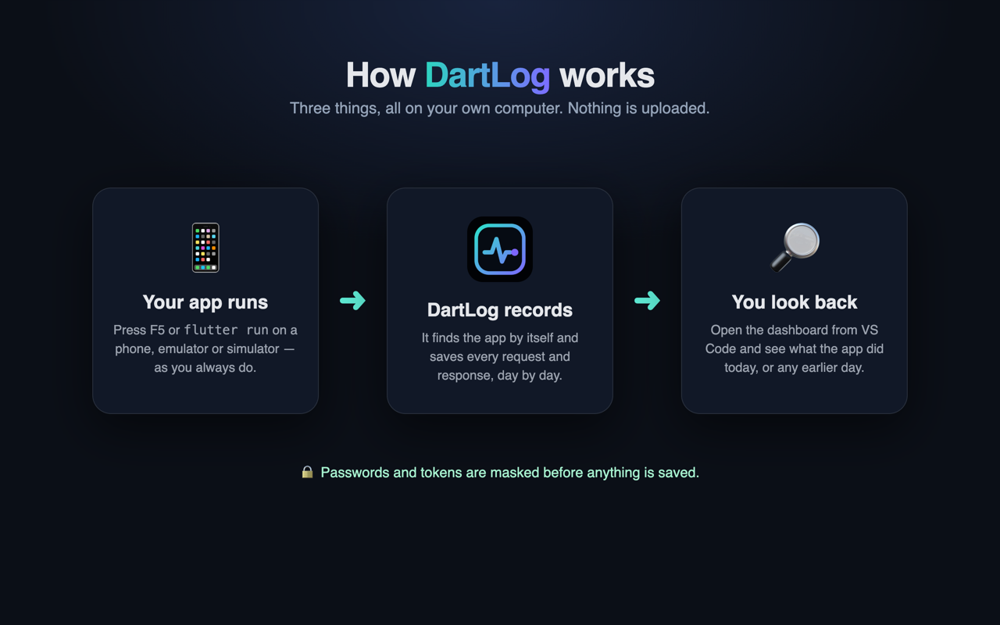
</p>

## Highlights

| | |
| --- | --- |
| ⚡ **No code changes** | DartLog finds your running debug app by itself. Nothing to add to your project. |
| 📅 **History by day** | Every request is kept and grouped by app and date, not lost when the app stops. |
| 🔴 **Live** | New requests appear on the dashboard as they happen. |
| 🔍 **Full detail** | Headers, bodies (with a JSON viewer), timings, errors, and copy as cURL. |
| 🌊 **Waterfall** | See which calls ran at the same time, which waited for each other, and where time was lost. |
| 📊 **Insights** | Error rate, slowest endpoints and busiest hours at a glance. |
| 🔒 **Private** | Everything stays on your computer. Passwords, tokens and card numbers are masked before saving, and you can test it. |
| 📱 **Phones and emulators** | Android phones and emulators, iPhones and iOS simulators. |
| 🧩 **VS Code** | A sidebar with today's requests, and DartLog in the Dart status menu. |
| 💻 **Terminal** | Look up apps, requests and numbers with `dartlog` commands. |

## Install

| System | Status |
| --- | --- |
| macOS (Apple Silicon and Intel) | ✅ Supported |
| Linux (x64 and ARM) | 🧪 Beta |
| Windows (x64 and ARM) | 🧪 Beta |

You need **Python 3.8 or newer** (already on macOS and most Linux).
Open a terminal and paste:

**macOS and Linux**

```sh
curl -fsSLO https://github.com/Manish1Pandey/dartlog-releases/releases/latest/download/setup.py
python3 setup.py
```

**Windows** (PowerShell)

```powershell
iwr https://github.com/Manish1Pandey/dartlog-releases/releases/latest/download/setup.py -OutFile setup.py
python setup.py
```

The installer:

1. downloads DartLog for your computer and checks it is genuine (SHA-256);
2. installs what DartLog needs, such as the PostgreSQL database and Android's
   `adb`, using your system's package manager (it asks before installing);
3. starts DartLog in the background, so it is always ready, even after a
   restart;
4. opens the dashboard in your browser.

> **macOS: install from the terminal, as shown above.** Don't download the
> `dartlog` file through a browser: macOS blocks downloaded programs that are
> not signed through Apple ("can't be opened because Apple cannot check it").
> If you already did, right-click the file and choose **Open**, or run
> `xattr -d com.apple.quarantine dartlog` once.

No Python? Use `bootstrap.sh` (macOS/Linux) or `bootstrap.ps1` (Windows) from
the [latest release](https://github.com/Manish1Pandey/dartlog-releases/releases/latest);
they install Python first.

## How to use it

1. **Run your Flutter app as usual:** press **F5** in VS Code or run
   `flutter run`, on a phone connected by USB, an emulator or a simulator.
2. **Open the dashboard** at **http://127.0.0.1:9300**, or click
   **`{ }` → DartLog** in the VS Code status bar if you installed the
   [VS Code extension](#vs-code-extension).
3. Your app appears under **Connected apps** and its requests start to show up.
   Come back any time: everything is kept by day.

**Nothing showing up yet?** Until the first request arrives, the Overview shows
a short checklist: *DartLog is running*, *Phone connected*, *App running in
debug* and *First request recorded*. Each step ticks itself off, and the one
that is still open tells you what to do next (for example, accept the "Allow
USB debugging" prompt on your phone).

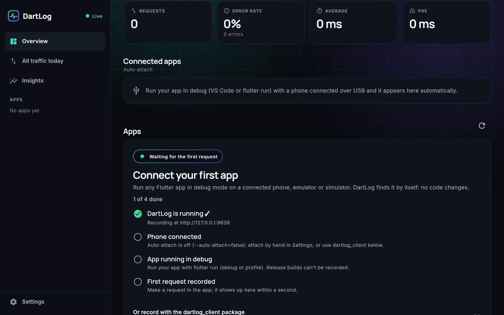

### A quick look

**Overview: every app you've worked on, and today's numbers**

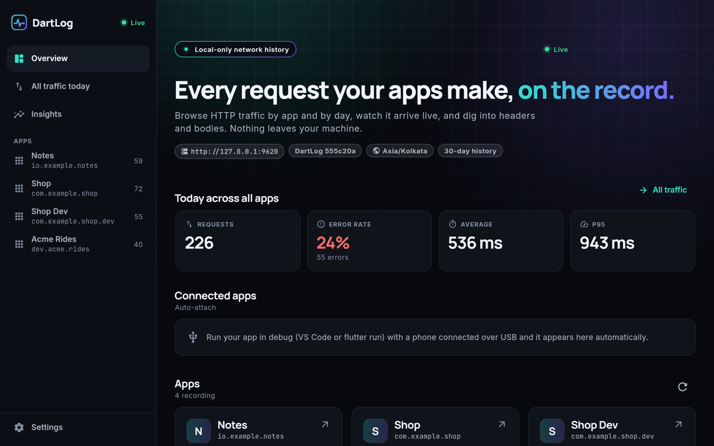

**One app's history, day by day**

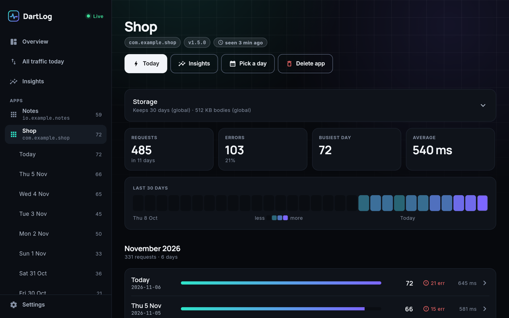

**Today: requests by hour, status codes and the busiest endpoints**

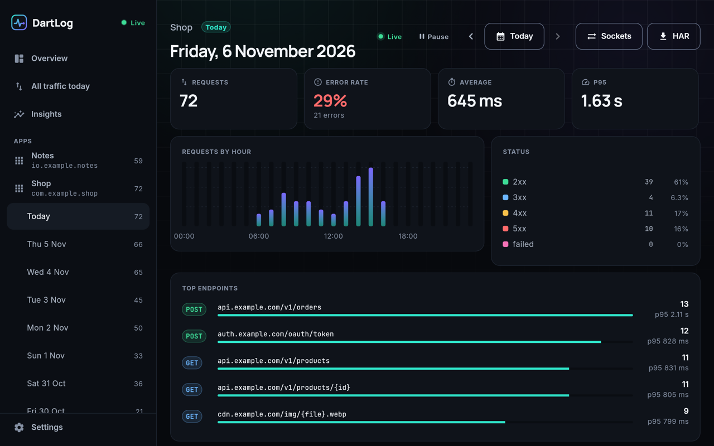

**Every detail of a single request**

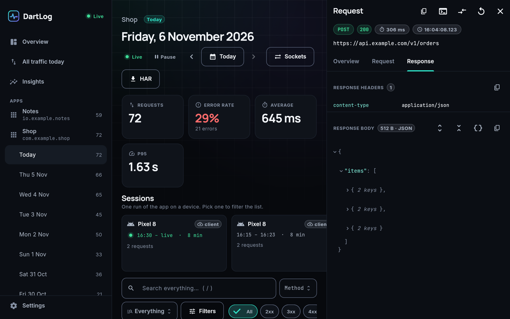

## What's new in 0.2.0

### Waterfall: see your app's calls on a timeline

Click **Waterfall** above a day's request list (or next to a session) to see
every request as a bar on a timeline. Bars side by side ran **at the same
time**; bars one after another **waited for each other**. DartLog also points
out the slowest chain of calls, idle gaps, failed calls and the same call made
twice. Hover a bar for details, click it to open the request.

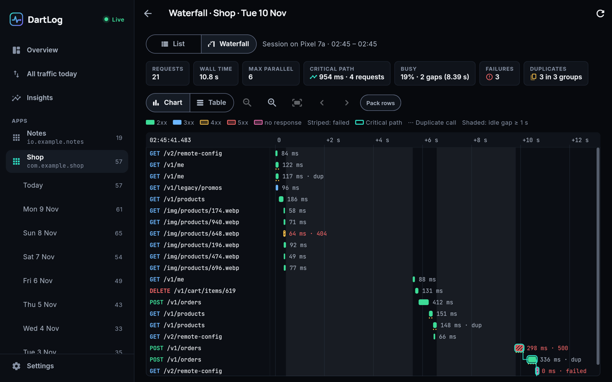

### Terminal commands

Prefer the terminal? Ask DartLog straight from it. DartLog must be running
(it is, if you used the installer).

| Command | Shows |
| --- | --- |
| `dartlog apps` | Your apps, with today's requests and errors |
| `dartlog requests` | The newest requests as a table. Add filters such as `--app`, `--date yesterday`, `--status 4xx` or `--search orders` |
| `dartlog show <UID>` | One request in full. Add `--curl` to get a command you can run again |
| `dartlog stats` | A day's numbers: requests, error rate, average and slowest times, top endpoints |

Add `--json` to any of them to use the output in a script.

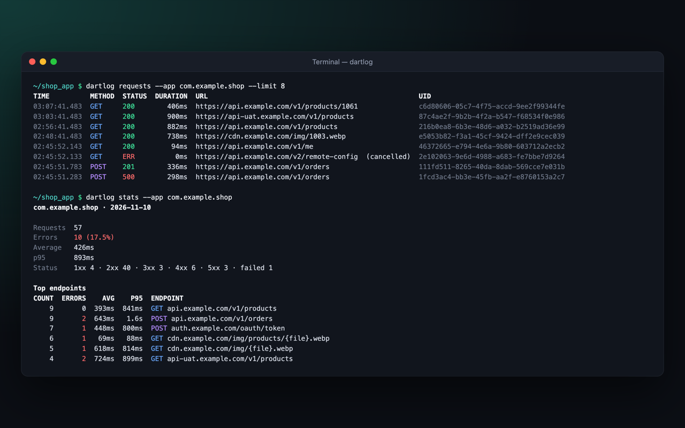

### Test what gets masked

DartLog hides passwords, tokens, cookies and card numbers before it saves
anything. To see it for yourself, open **Settings → Masking**, paste a URL,
some headers or a JSON body, and click **Test masking**: DartLog shows exactly
what it would store. Nothing you paste is saved.

Your app has its own secret fields, like `national_id`? Pick the app and add
them as **custom keys**; they are masked from then on.

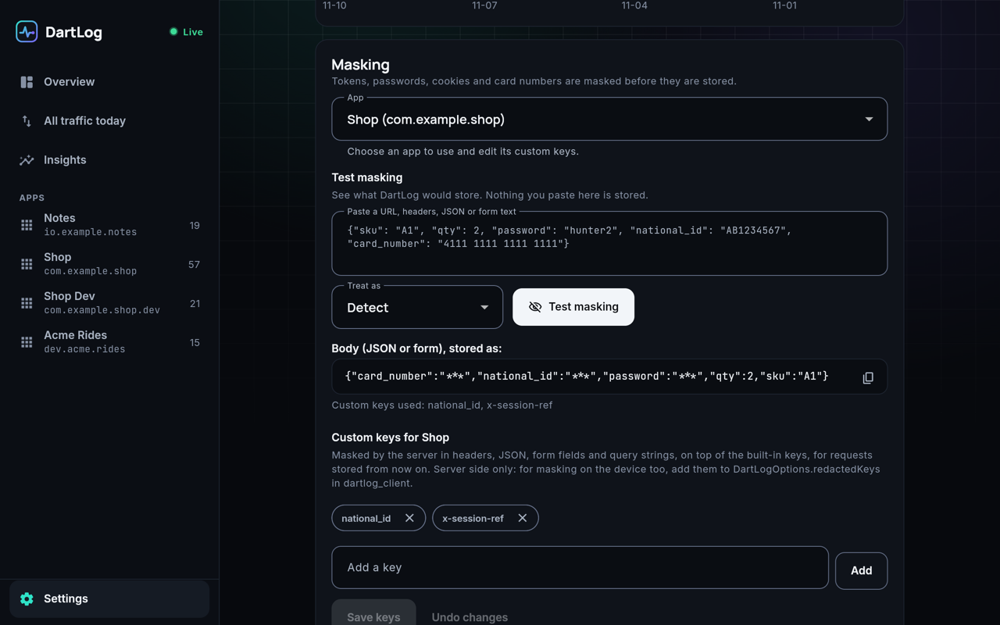

## VS Code extension

**A DartLog sidebar.** Click the DartLog icon in the Activity Bar to see
today's requests of the app you are debugging; new ones appear by themselves. Click a request
to read it in an editor tab. Right-click to copy it as cURL or as a URL, or to
open it in the dashboard. You can filter the list or show only errors. While
you debug, the status bar shows today's count of requests and errors.

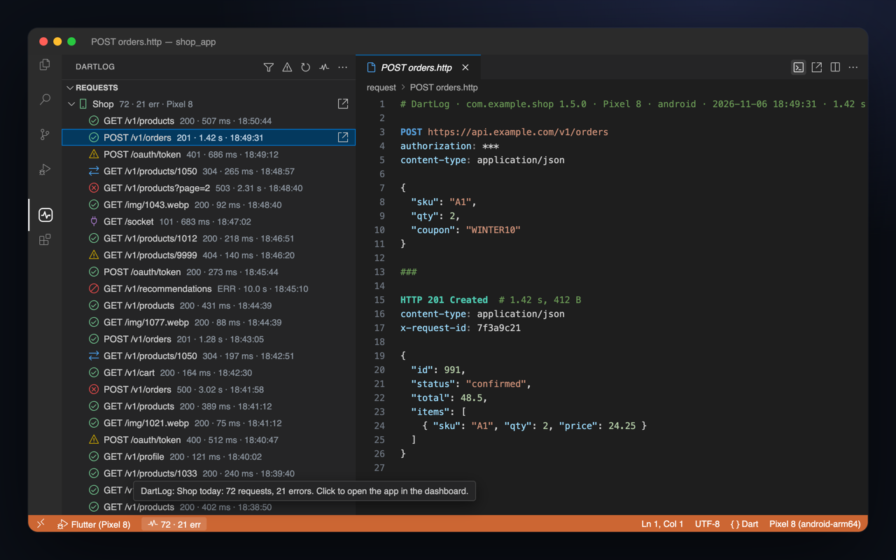

**In the Dart status menu.** DartLog also appears in the `{ }` menu with an
**Open** button (or **Launch** when DartLog is stopped).

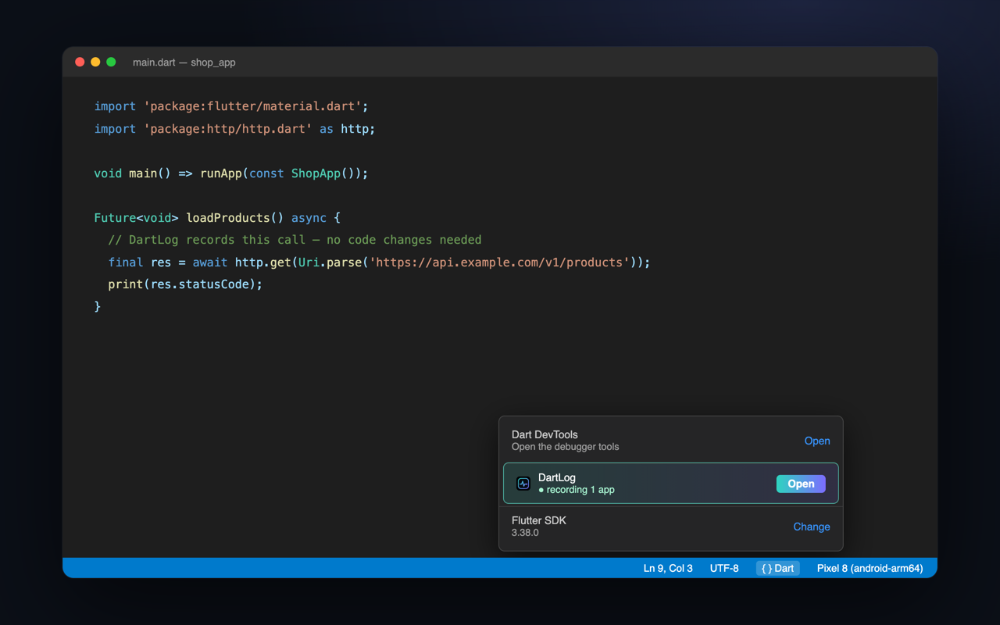

Download `dartlog-<version>.vsix` from the
[latest release](https://github.com/Manish1Pandey/dartlog-releases/releases/latest),
then in VS Code open the **Extensions** view, click **⋯ → Install from VSIX…**
and pick the file.

**No DartLog yet? The extension installs it for you.** After installing the
extension, open the DartLog panel and click **Install DartLog**. A terminal
runs the official installer (the same steps as [Install](#install)), and the
dashboard opens when DartLog is ready.

## Updating

DartLog tells you on the dashboard when a newer version is out. To update,
run the installer again:

```sh
python3 setup.py update
```

Your recorded history and settings are kept.

## Uninstalling

```sh
python3 setup.py uninstall
```

This stops DartLog and removes the program. Your recorded data and database
are kept unless you choose to delete them.

## Troubleshooting

Start with the built-in check. It tests every part and says what to fix:

```sh
python3 setup.py doctor
```

| Problem | Fix |
| --- | --- |
| The dashboard doesn't open | Run `python3 setup.py repair`, then open http://127.0.0.1:9300 |
| My app doesn't show up | Run it in **debug** mode (F5 or `flutter run`). For a phone, connect it by USB and allow USB debugging. |
| An iPhone isn't found | Connect it once by cable and trust this computer; after that it also works over Wi-Fi. |
| Something else | [Open an issue](https://github.com/Manish1Pandey/dartlog-releases/issues) with the output of `python3 setup.py doctor`. |

## Privacy and security

- DartLog runs **only on your computer** and listens on `127.0.0.1`, so other
  devices on your network can't see it.
- Recorded traffic is stored in a local PostgreSQL database. **Passwords,
  tokens, cookies and card numbers are masked before they are saved.** You can check what is masked in Settings → Masking.
- DartLog sends nothing anywhere. Once a day it asks GitHub whether a new
  version exists; turn that off with `DARTLOG_CHECK_UPDATES=0`.

## License

DartLog is free to download and use. It is proprietary software:
© 2026 Manish Pandey, all rights reserved. See [LICENSE](LICENSE).
